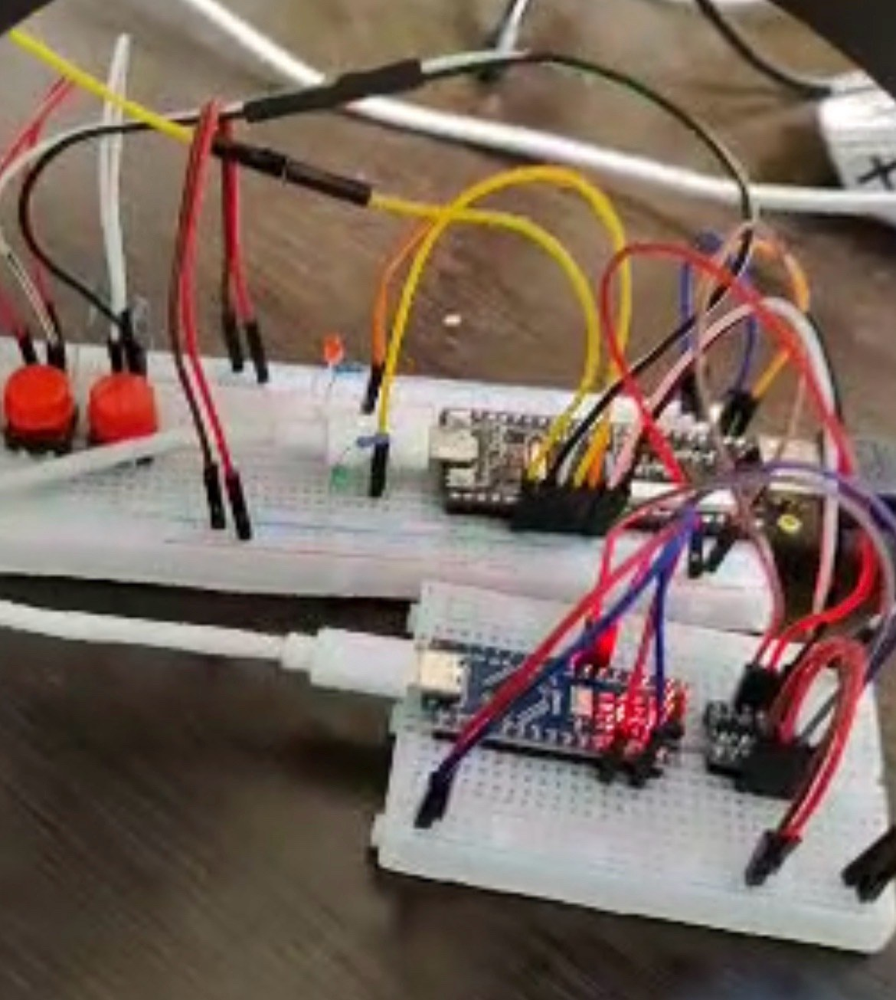
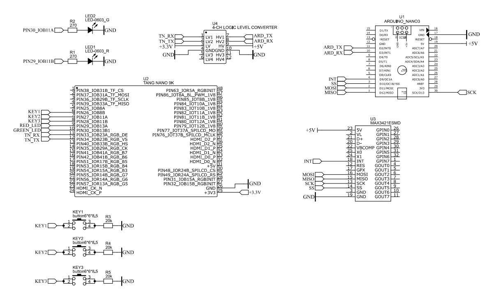

# USB-Guard

Аппаратный сканер USB-накопителей. Arduino Nano с USB Host Shield читает флешку посекторно и ищет в данных байтовые сигнатуры. FPGA Tang Nano 9K выводит журнал сканирования на монитор по HDMI и показывает результат светодиодами.

Командная курсовая работа трёх студентов по дисциплине «Электроника и схемотехника». Исходный репозиторий проекта: [omlord10/USB-Guard](https://github.com/omlord10/USB-Guard).

<p align="center"></p>

## Как это работает

| Узел | Что делает | Исходники |
|---|---|---|
| Arduino Nano + USB Host Shield 2.0 (MAX3421E) | Определяет накопитель, читает его секторами по 512 байт и передаёт каждый сектор движку сигнатур | [arduino/arduino_main](arduino/arduino_main/) |
| Движок сигнатур | Потоковый поиск байтовых шаблонов. Хранит последние 31 байт предыдущего блока, поэтому находит сигнатуру, разорванную границей секторов | [signature_engine.c](arduino/arduino_main/signature_engine.c) |
| Tang Nano 9K (Gowin GW1NR-9C) | Принимает текст по UART и показывает его как терминал на HDMI 640×480 при 60 Гц, управляет светодиодами, передаёт нажатия кнопок обратно на Arduino | [fpga/src](fpga/src/) |

Узлы связаны по UART 9600 8N1 через преобразователь уровней 5 В / 3,3 В.

Файловая система не разбирается. Поэтому сканер не зависит от того, как отформатирован накопитель, и видит данные удалённых файлов, но сообщает номер сектора, а не имя файла.

База сигнатур лежит в [signatures.h](arduino/arduino_main/signatures.h). В ней 32 байта тестовой строки EICAR и один демонстрационный шаблон. Движок не зависит от платформы и собирается обычным компилятором C.

## Схема



| Arduino Nano | Tang Nano 9K | Назначение |
|---|---|---|
| D3 (TX, SoftwareSerial) | P34 | Текст журнала и коды состояния |
| D2 (RX, SoftwareSerial) | P33 | Команды от кнопок |
| D9–D13 | – | USB Host Shield по SPI |

## Управление

| Кнопка | Вывод Tang | Действие |
|---|---|---|
| KEY1 | P26 | Сдвинуть начало сканирования на 100 секторов |
| KEY2 | P27 | Сдвинуть на 10 000 секторов |
| KEY3 | P28 | Сдвинуть на 1 000 000 секторов |
| S1 на плате | P4 | Начать сканирование с выбранного сектора |
| S2 на плате | P3 | Сбросить смещение в ноль |

Любое нажатие во время сканирования его прерывает. Те же команды принимаются из Serial Monitor: `h`, `k`, `m`, `s`, `res`.

## Индикация

| Состояние | Зелёный (P29) | Красный (P30) |
|---|---|---|
| Готов, накопитель подключён | медленно мигает | выключен |
| Накопителя нет | одиночные вспышки | выключен |
| Идёт сканирование | мигают попеременно | мигают попеременно |
| Сигнатур не найдено | горит | выключен |
| Найдена сигнатура | выключен | горит |
| Ошибка | быстро мигает | быстро мигает |

При первом совпадении сканирование останавливается, на экран выводятся номер сектора и имя сигнатуры.

## Сборка и прошивка

**FPGA.** Открыть `fpga/usbguard.gprj` в Gowin EDA, выполнить Synthesize и Place & Route, затем Program Device.

**Arduino.** Открыть `arduino/arduino_main/arduino_main.ino` в Arduino IDE, установить библиотеку USB Host Shield Library 2.0, выбрать плату Arduino Nano (ATmega328P) и загрузить скетч.

Скетч `arduino/test_hdmi` нужен для отладки без накопителя: он имитирует сканирование и проверяет связку UART, светодиоды и вывод на HDMI.

## Структура репозитория

```
├── arduino/
│   ├── arduino_main/      основная прошивка, движок и база сигнатур
│   └── test_hdmi/         тестовый скетч без USB
├── fpga/
│   ├── usbguard.gprj      проект Gowin EDA
│   └── src/
│       ├── top.v          мост UART, светодиоды, терминал HDMI
│       ├── uart_rx.v, uart_tx.v
│       ├── svo_hdmi.v     обёртка над SVO с входом для символов терминала
│       ├── hdmi/          библиотека SVO без изменений
│       ├── gowin_rpll/, gowin_clkdiv/   тактирование: 27 → 126 → 25,2 МГц
│       └── usbguard.cst, usbguard.sdc   назначение выводов и ограничения по времени
└── docs/                  схема и фотография прототипа
```

## Ограничения

- Сигнатуры зашиты в прошивку, для обновления базы её нужно пересобрать.
- Поиск останавливается на первом совпадении.
- Скорость ограничена интерфейсом USB Full Speed и ресурсами ATmega328P.
- Терминал выводится поверх тестовой таблицы библиотеки SVO.

## Лицензии

Код проекта распространяется по лицензии MIT, текст в файле [LICENSE](LICENSE). Каталог `fpga/src/hdmi` и файл `fpga/src/svo_hdmi.v` основаны на библиотеке SVO (Simple Video Out) Клиффорда Вольфа, лицензия ISC. Файлы в `gowin_rpll` и `gowin_clkdiv` сгенерированы Gowin EDA.
